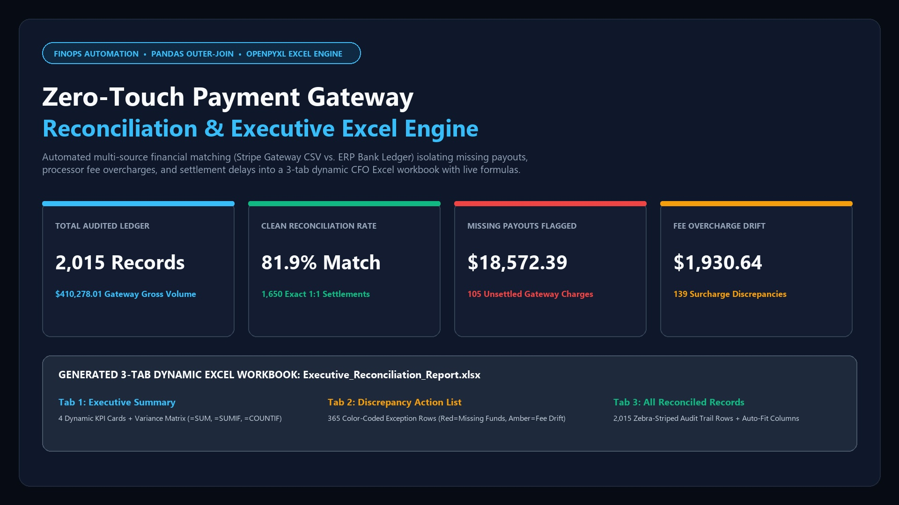
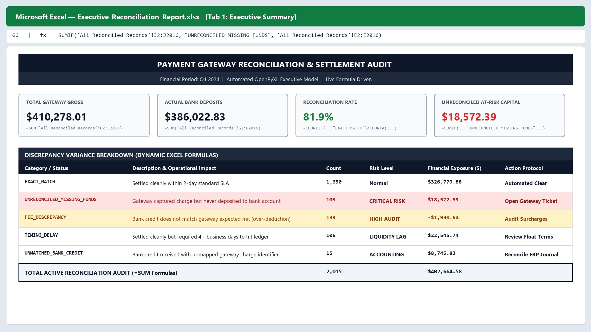
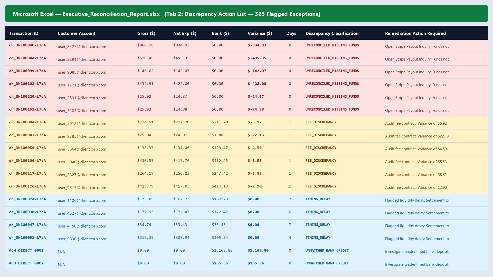

# Zero-Touch Payment Gateway Reconciliation & Executive Reporting Engine ⚡📊

[](https://www.python.org/)
[]()
[]()

An automated FinOps reconciliation engine that cross-references **Stripe/Payment Gateway transaction exports** (`gateway_charges.csv`) against **ERP/Bank settlement ledgers** (`bank_ledger.csv`), isolates missing capital and processor fee drift, and generates a **3-tab dynamic CFO Excel workbook** (`Executive_Reconciliation_Report.xlsx`) with live Excel formulas (`=SUM`, `=SUMIF`, `=COUNTIF`).



---

## 📊 Empirical Reconciliation Benchmark (`2,015` Ledger Entries)

| Reconciliation Category | Record Count | Financial Exposure | Action Protocol |
| :--- | :--- | :--- | :--- |
| **`EXACT_MATCH`** | `1,650` (`81.9%`) | `$326,779.88` Settled | Automated Clear (Within 2-Day SLA) |
| **`UNRECONCILED_MISSING_FUNDS`** | `105` | **`$18,572.39` At Risk** | Open Gateway Payout Inquiry |
| **`FEE_DISCREPANCY`** | `139` | **`-$1,930.64` Fee Drift** | Audit Merchant Surcharge Contract |
| **`TIMING_DELAY`** | `106` | `$22,545.74` Delayed | Review Bank Settlement Float (>3 Days) |
| **`UNMATCHED_BANK_CREDIT`** | `15` | `$8,745.83` Unmapped | Reconcile ERP Journal Entry |

### Tab 1: Executive Summary (Dynamic KPI Cards & Live `=SUMIF` Formulas)


### Tab 2: Discrepancy Action List (365 Color-Coded Exception Rows)


---

## ⚡ Quickstart

```bash
pip install -r requirements.txt

# 1. Generate synthetic gateway & bank ledger CSVs (2,000+ rows)
python generate_financial_sources.py

# 2. Run reconciliation engine & build 3-tab Excel model
python reconcile_engine.py
```

### Sample Deliverable Files Included in Repository
- **[`Executive_Reconciliation_Report.xlsx`](Executive_Reconciliation_Report.xlsx)**: Generated 3-tab dynamic Excel workbook.
- **[`gateway_charges.csv`](gateway_charges.csv)** & **[`bank_ledger.csv`](bank_ledger.csv)**: Source financial ledgers.
